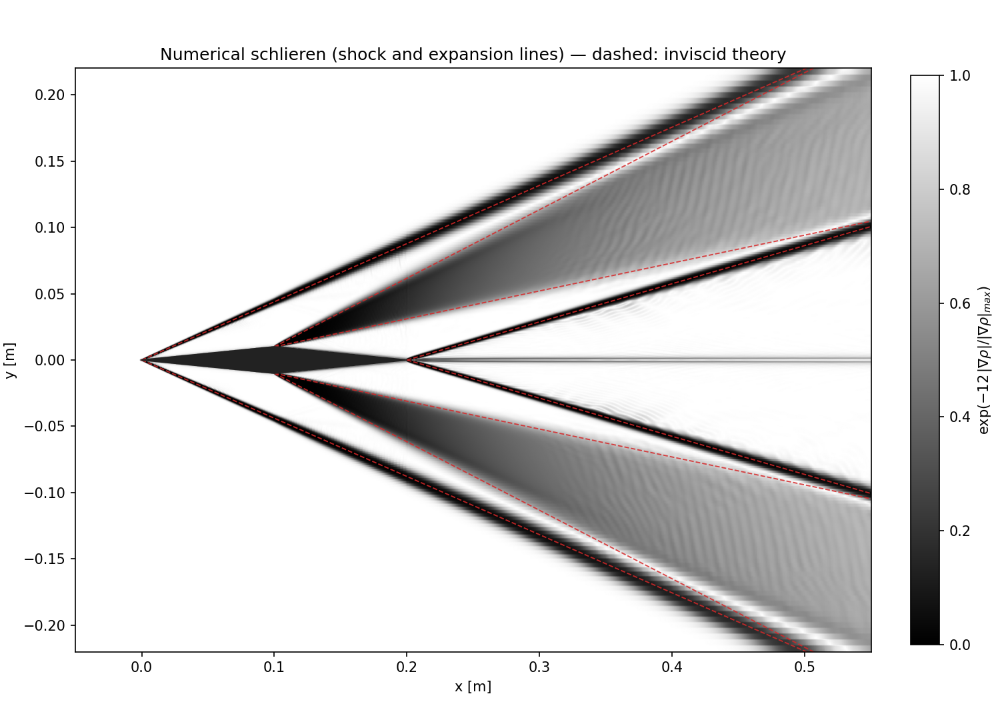
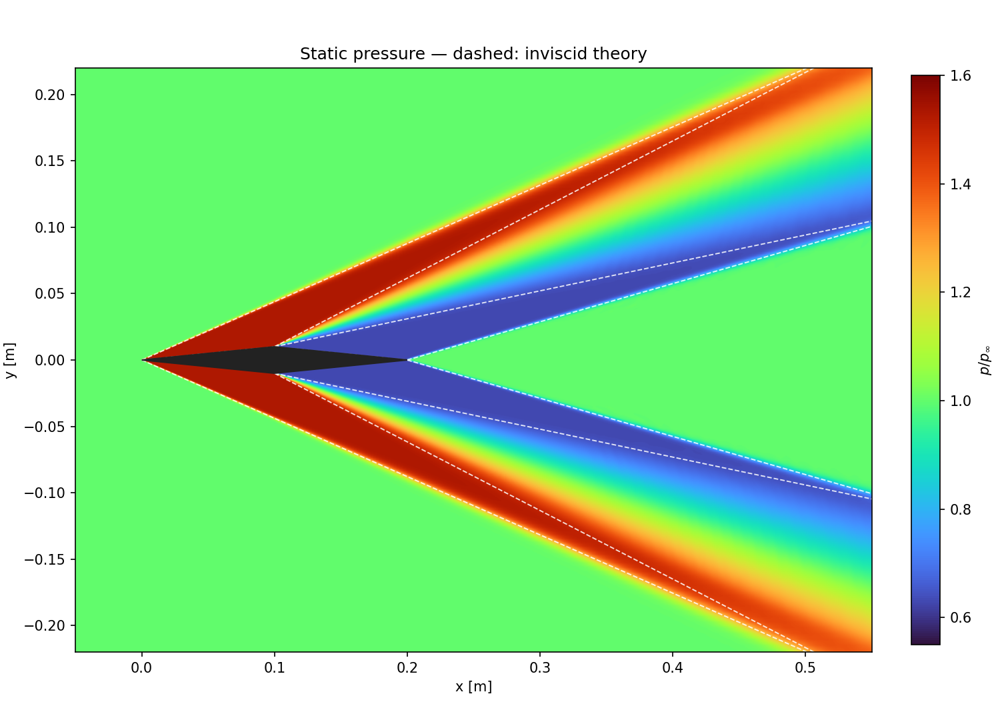
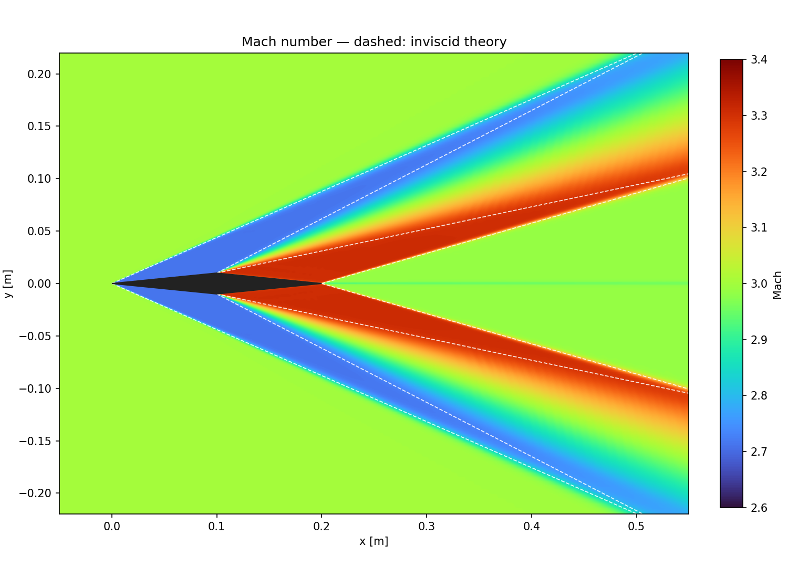
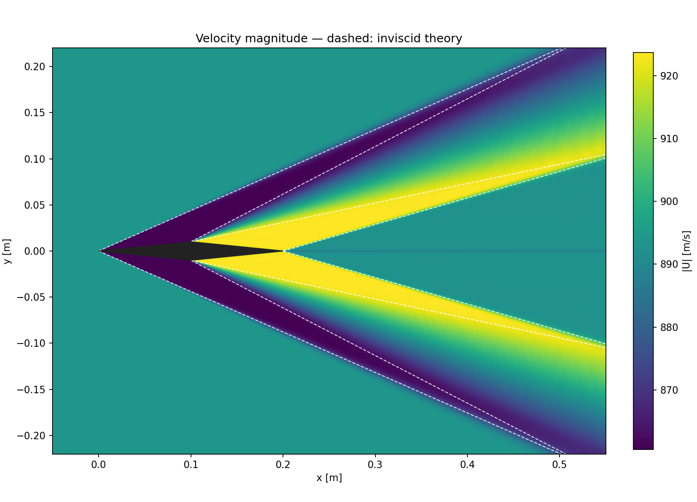
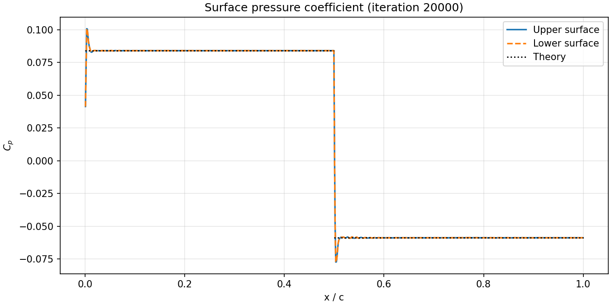
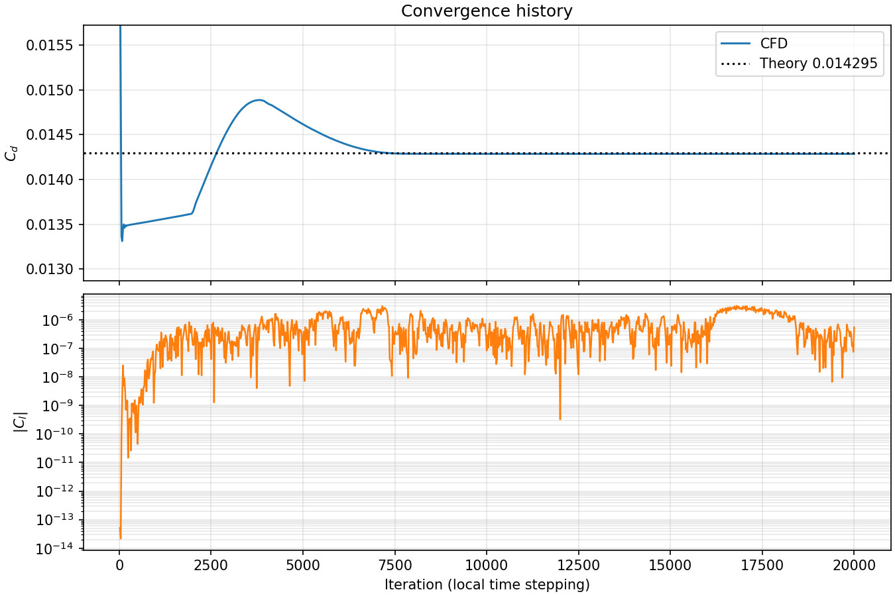

# Diamond Airfoil — Mach 3 Steady Euler (OpenFOAM)

2D inviscid (Euler) OpenFOAM simulation of supersonic flow over a diamond airfoil. All case files are generated from C++ rather than written by hand, and results are compared against oblique-shock and Prandtl–Meyer theory.

## Problem

| Parameter | Value |
|---|---|
| Mach number | 3 |
| Angle of attack | 0° |
| Altitude | 80,000 ft (24,384 m), US Standard Atmosphere |
| Freestream | T = 220.94 K, p = 2801.5 Pa, ρ = 0.04417 kg/m³, U = 893.9 m/s |
| Airfoil | Chord 0.2 m, thickness 0.02 m (t/c = 10%), half-angle θ = 5.71° |
| Domain | x = −1…4 m, y = −2.5…2.5 m |
| Mesh | 1,200,000 hexahedral cells, refined around the airfoil |

## Method

- **Solver:** OpenFOAM Foundation 14, `foamRun` + `shockFluid`
- **Model:** Euler (zero viscosity), perfect gas, γ = 1.4
- **Time stepping:** `localEuler` (local time stepping) to steady state, `maxCo = 0.2`
- **Flux scheme:** Kurganov with `Minmod` / `MinmodV` limiters
- **Parallel:** 20 MPI processes

> **Note:** `Time` in the log is the **iteration count**, not physical seconds.

## Repository layout

```text
src/
  CaseConfig.hpp       Mach, altitude, angle, geometry, standard atmosphere
  generateCase.cpp     Generates mesh, boundary conditions and OpenFOAM dictionaries
  inletVelocity.C      Inlet velocity boundary condition (codedFixedValue)
  diagnostics.C        Pressure force, Cl/Cd and mass balance
  shockReference.cpp   Analytical oblique shock + expansion solution
0/ constant/ system/   Generated OpenFOAM input files
validation/            Theoretical reference and serial/parallel test
monitor.py             Live convergence monitor
analyze.py             Post-processing
plot_results.py        README figures and results.json
docs/                  Result figures and numbers
Allrun                 End-to-end run script
```

## Running

Requirements: Ubuntu, OpenFOAM Foundation 14 (`/opt/openfoam14`), `g++` (C++17), Python 3.

```bash
bash Allrun > log.Allrun 2>&1
```

`Allrun` generates the case, builds the mesh, runs `checkMesh`, decomposes, solves in parallel and reconstructs the latest time. A lock prevents two runs at once.

**Monitor** (in a second terminal):
```bash
watch -n 10 python3 monitor.py
```

**Stop and save:**
```bash
foamDictionary system/controlDict -entry stopAt -set writeNow
```
To resume, set `stopAt` back to `endTime` and rerun `Allrun`; it continues from the latest write.

**Visualise:**
```bash
paraview --no-mpi diamond.foam
```
Use *Case Type → Decomposed Case* while running, *Reconstructed Case* after completion.

**Changing parameters:** edit `src/CaseConfig.hpp` and generate a case in a new directory (existing results are never overwritten):
```bash
mkdir -p build
g++ -std=c++17 -O2 src/generateCase.cpp -o build/generateCase
build/generateCase /path/to/new/case
```

## Convergence criteria

After at least 5000 iterations, `monitor.py` checks the last 2000:

| Quantity | Threshold |
|---|---|
| Cd variation | < 1e−5 |
| \|Cl\| | < 1e−5 |
| Normalised net mass flux | < 1e−4 |
| ΔCp RMS (every 20 iterations) | < 1e−5 |

## Results

Final solution after 20,000 iterations. Dashed lines in the field plots are the inviscid oblique-shock / Prandtl–Meyer theory.

| Quantity | CFD | Theory | Difference |
|---|---|---|---|
| Cd (wave drag) | 0.014286 | 0.014295 | −0.06% |
| Cl | 5.5e−7 | 0 | — |
| Front surface p/p∞ | 1.5296 | 1.5299 | −0.02% |
| Rear surface p/p∞ | 0.6296 | 0.6293 | +0.04% |
| Leading-edge shock angle β | 23.8° | 23.70° | +0.5% |

The shock angle is estimated by fitting a line to the maximum density gradient, so it is limited by the sampling resolution. Numbers are in `docs/results.json`.

### Numerical schlieren: shocks and expansion fans


### Static pressure


### Mach number


### Velocity magnitude


### Surface pressure coefficient


### Convergence


Cd settles at the theoretical value after about 7,500 iterations and stays there. Over the last 2,000 iterations Cd, Cl and surface pressures meet the convergence criteria; the mass-flux balance and the field-wide ΔCp RMS (8.8e−5) do not, which points to small residual oscillations in the flow field away from the airfoil.

Regenerate all figures with:
```bash
python3 plot_results.py
```

## Validation

**Analytical reference:** `validation/theory.txt` (oblique shock + Prandtl–Meyer expansion), compared in the Results table above.

**Mesh quality:** `checkMesh` → Mesh OK, max non-orthogonality 5.71°, max skewness 0.244.

**Serial vs. parallel test** (12,000 cells, 40 iterations): Cd and Cl differ by < 1e−6.

## Limitations

- Inviscid: Cd is **pressure (wave) drag only**; no skin friction, heat transfer or boundary layer.
- 2D: no finite-span effects.
- No mesh-independence study yet.
- Not all convergence criteria are met (see Convergence above).

## References

- NASA Glenn, *Oblique Shock Waves*: https://www.grc.nasa.gov/WWW/BGH/oblique.html
- *U.S. Standard Atmosphere, 1976*, NASA-TM-X-74335
